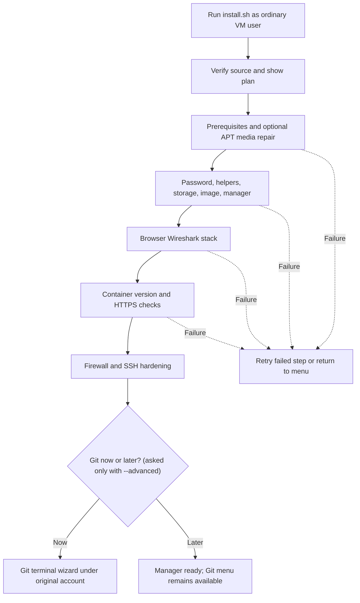

# Guided VM installation

One terminal installer takes an Ubuntu Server 24.04 VM from a bare account to a
running manager with the browser Wireshark stack and, if you want it, Git setup. This
page explains what its menu, phases and options do. The
[quick install](QUICK-INSTALL.md) is the paste-only version of the same route and the
[fresh VM guide](FRESH-VM-GUIDE-V2.md) starts before Ubuntu is installed.

Every command below works from any directory. The guides keep the source in
`~/projects/clab-manager`; replace that path if you cloned elsewhere.

## Before you start

Check the VM clock; APT and Git refuse to work with a wrong one:

```bash
date -u
timedatectl status
```

Compare UTC with a trusted current clock. After a Proxmox snapshot rollback the
clock is usually stuck at the snapshot time; paste this to resynchronise now:

```bash
sudo timedatectl set-ntp true
sudo systemctl restart systemd-timesyncd
sleep 10
date -u
timedatectl status
```

If the date is still wrong, or APT reports `not valid yet` / `expired`, follow
[the clock fix](FRESH-VM-GUIDE-V2.md#fix-the-clock), which includes a manual
bootstrap for a VM that cannot reach a time server, and
[clock recovery](FRESH-VM-GUIDE-V2.md#recovery-c) for a paused installer.

Then get the source and start the installer as your ordinary account, **without
sudo** (it asks for sudo where the VM needs it):

```bash
command -v git >/dev/null || sudo apt-get install -y git
git clone https://github.com/ArchRuger/CLAB-BACKUP-WORKER-v2.git "$HOME/projects/clab-manager"
bash "$HOME/projects/clab-manager/deploy/install.sh"
```

The installer requires the Python 3 and sudo normally present on Ubuntu Server; it
explains missing requirements. Internet access is needed for packages, images and
GitHub.

## Terminal menu

```text
Containerlab Node Manager 1.32.1 — guided setup
Linux account: your existing VM account
Persistent home: /home/your-account
Source: /home/your-account/projects/clab-manager

Setup menu
  1. Install or update manager, then set up Git
  2. Git setup / repair only (no rebuild)
  3. VS Code / Containerlab extension access for your-account (no rebuild)
  4. Browser Wireshark stack only (reinstall or upgrade, no rebuild)
  5. Check running installation
  6. Exit
```

Enter a number and press Enter. The plain menu works over SSH and VM consoles without
curses, a desktop browser or extra terminal UI packages, and it is what a fresh VM
opens. Commands that need passwords or GitHub device authorisation keep the terminal
attached.

A full-screen front end for the same steps is optional. `install.sh --setup-tui` installs
its pinned packages once for your account (nothing else on the VM changes); after that a
plain `install.sh` opens it on a capable terminal. `--tui` starts it (setting it up
first if needed), `--plain` forces the numbered menu, and `--git` and `--advanced` work
in both. Details: [installer-tui/README.md](installer-tui/README.md). The rest of this
page describes the steps, which are the same in both.

## What the full installation does

Menu **1** takes the standard, documented choices automatically: an existing
`clab-backup-ui/.env` is retained unchanged and a missing one gets the defaults (all
VM interfaces, HTTPS on port 8443, a plain-HTTP redirect on port 8081); a self-signed
certificate is made if none exists; reviewed lab operations are enabled; the host
firewall and a conservative SSH drop-in are set up; VS Code /
Containerlab extension access is set up for your account; obsolete
installation-media APT entries are backed up and disabled if present. It prints the
plan below, starts immediately (no "Proceed with this plan?" prompt), and runs
Git setup as part of the same item once the manager is ready — which is exactly
what "Install or update manager, then set up Git" says. Add `--advanced` to the
command that starts the installer to ask every one of those questions again,
including copying `.env` from a previous source folder, the port question of an
upgrade ([Ports](#ports)), whether to set up the firewall and the SSH drop-in
([Firewall and SSH](#firewall-and-ssh)), and whether to set up Git now or later:

```bash
bash "$HOME/projects/clab-manager/deploy/install.sh" --advanced
```

| Phase | What happens |
|---|---|
| 1 Administrator access and settings | Confirms sudo; retains an existing `clab-backup-ui/.env` or copies one from another folder without showing its contents. Defaults are all VM interfaces, HTTPS on port 8443 and a plain-HTTP redirect on port 8081. |
| 2 VM prerequisites | Installs missing Git, SSH, Docker/Compose and containerlab and starts the services. Compatible tools stay installed; conflicting Docker packages stop with instructions. A previously disabled Docker source gets a specific recovery message. Optionally backs up and disables obsolete installation-media APT entries; network mirrors and signature checks stay. |
| 3 Password, helpers, image and manager | Runs the launcher (`start-manager.sh --manager-only`): prepares persistent storage, creates or retains the restricted `clab-discovery` password, installs and verifies the VM helpers through the restricted account and gateway, makes the [TLS certificate](#tls-and-the-certificate) if none exists (`setup-tls.sh`, before the image build), builds the image and creates the manager and its redirect listener. The manager starts with no accounts and waits for its first administrator. |
| 4 Browser Wireshark capture stack | Pulls the pinned Wireshark image, builds the session service from this source, starts Edgeshark on localhost 5001/5801, writes the capture settings and recreates the manager so it loads them. |
| 5 Running manager verification | Checks the Compose container, the application version and the HTTPS response on the actual bind address and port, with the installed certificate as the only trusted one. Prints the certificate's SHA-256 fingerprint. |
| Firewall | Unless skipped in `--advanced`: `setup-firewall.sh` ([Firewall and SSH](#firewall-and-ssh)). It runs after the manager verification and allows the SSH ports first. |
| SSH hardening | Unless skipped in `--advanced`: `setup-ssh-hardening.sh` ([Firewall and SSH](#firewall-and-ssh)). |
| 6 Engineer access for VS Code | Only when chosen (standard path: always; `--advanced`: on request): `docker` and `clab_admins` groups for your account, group-writable trusted lab folders, the containerlab SUID mode. |

Right after the numbered phases, the installer installs or updates
[lazydocker](#lazydocker) for your account, as its own ordinary-user step that never
fails the installation, then runs Git setup. On the VM prerequisites phase, a
package (dpkg/APT) lock held by another process — commonly `unattended-upgrades` —
gets its own [recovery menu](#recovering-from-a-package-lock) instead of the
generic retry choice.

Before APT updates, both installation paths display UTC/NTP status and wait up
to 30 seconds only for already-active NTP. The check is read-only; the installer
does not set the clock or change time services, servers or timezone.



Each phase offers **Retry this step** or **Return to menu** on failure, so a failed
image pull or plugin download is retried on its own without repeating the password,
helper and image-build step. Existing manager data, passwords, registered Git
repositories and lab containers are retained. Source installation does not migrate
data out of an old container that lacks persistent storage; use
[the migration guide](STANDALONE-SETUP.md) first in that case.

The verification phase prints `Manager 1.32.1: running; HTTPS and version checks passed.`,
the VM-local address and the certificate's SHA-256 fingerprint. After the last step
(Git setup included) the installer prints the address to open, one or more
`https://…` addresses, and **the setup code, last of all**: a restart of the manager
while it has no accounts makes a new code, so the code on the screen is the one the
file holds when the installer ends. Then it exits to the shell (exit code 0); it
does not loop back to the Setup menu after a successful path. A failed or
cancelled step keeps today's behaviour instead: completed work stays in place, the
affected phase's Recovery menu offers **Retry this step** or **Return to menu**, and
a **Return to menu** choice reopens the Setup menu shown above. Open the printed
address, `https://VM_IP:8443` unless you changed the port, from your workstation
(the VM's LAN address, not the workstation's `127.0.0.1`), and
[finish in the browser](#finish-in-the-browser).

## Upgrades

Keep one source folder and pull into it; the installer detects what is installed
and refreshes all of it while keeping data, passwords and `clab-backup-ui/.env`:

```bash
git -C "$HOME/projects/clab-manager" pull --ff-only
bash "$HOME/projects/clab-manager/deploy/install.sh"
```

Choose **1** again. The launcher runs `retire-telemetry.sh --no-recreate` to tear
down any leftover telemetry stack from an older release, then rebuilds the manager
image, reinstalls the matching VM helpers, refreshes engineer access and the Git
helper where they were set up, and the capture stack phase rebuilds the capture
session service (its image carries the release). Running browser capture sessions
are removed during the upgrade; download saved captures first. A release that adds the
sign-in also changes the address from plain HTTP to HTTPS: read [Ports](#ports) for what
happens to your settings, and expect the first start to have no accounts
([Finish in the browser](#finish-in-the-browser)).
The standard upgrade also sets up `ufw`: it allows SSH, the TLS port and the redirect port and
denies all other incoming traffic ([Firewall and SSH](#firewall-and-ssh)). To keep managing the
firewall yourself, run `bash "$HOME/projects/clab-manager/deploy/install.sh" --advanced --no-firewall`.

The launcher alone does the same when run by hand and is what the installer calls:

```bash
sudo bash "$HOME/projects/clab-manager/deploy/start-manager.sh"
```

It runs `retire-telemetry.sh --no-recreate` first, then refreshes the capture stack
before it recreates the manager unless `clab-backup-ui/.env` says
`CAPTURE_PROVIDER=disabled` (written by the `--remove` option below), or
`--manager-only` is given. It also makes the self-signed certificate if none exists
(`setup-tls.sh`, [TLS and the certificate](#tls-and-the-certificate)) and stops before it
recreates a manager that could not start because the certificate files cannot serve.

## Browser Wireshark

The capture stack is part of every installation. Menu **4** reinstalls or upgrades
it without rebuilding the manager; the same script works on its own from any
directory and recreates the manager itself so it loads the new settings:

```bash
sudo bash "$HOME/projects/clab-manager/deploy/setup-capture.sh"
```

Its setup writes the Edgeshark and session service addresses as localhost ports
5001 and 5801 and the manager expects exactly those.

To take the stack down deliberately, add `--remove`. It stops the capture services
and writes `CAPTURE_PROVIDER=disabled` (the session token is kept). Later upgrades
respect the choice; running the script without `--remove` brings the stack back.
Details: [Browser Wireshark](CAPTURE.md).

To reload the manager after editing `clab-backup-ui/.env` by hand, without a
rebuild:

```bash
sudo bash "$HOME/projects/clab-manager/deploy/recreate-manager.sh"
```

## TLS and the certificate

The manager serves HTTPS itself: the `uvicorn` command in both Compose files carries
`--ssl-certfile /tls/cert.pem --ssl-keyfile /tls/key.pem` and `--no-proxy-headers`,
and there is no setting that turns TLS off. The files live in
`/srv/containerlab-node-manager/tls` on the VM (mounted read-only at `/tls` in the
container). The launcher (`start-manager.sh`) runs `setup-tls.sh` before it builds the
image, so a fresh installation has a certificate before the manager first starts.

| File in `/srv/containerlab-node-manager/tls` | Owner and mode | Content |
|---|---|---|
| the directory | root, `0755` | |
| `cert.pem` | root, `0644` | the certificate; for a provided one, the full chain, leaf first |
| `key.pem` | root with the container's group (10001), `0640` | the private key; your ordinary VM account cannot read it |
| `mode` | root, `0644` | one line: `self-signed` or `provided` |
| `names` | root, `0644` | optional: the extra names and addresses you gave with `--name`, one per line |

The key never leaves the VM. A `.lock` file in the same folder serialises the commands
below; leave it alone.

### The default: a self-signed certificate

Without any option `setup-tls.sh` makes sure a self-signed certificate exists, with its key
and the names below. It is an ECDSA P-256 certificate valid for **730 days**, made with
`openssl` on the VM. The installer and every upgrade run it; it keeps the certificate it
finds unless the certificate is missing, unreadable, expired, expires within 30 days or lacks
one of the names the VM needs, and then makes a new one (new key, new fingerprint) and
recreates the manager so it serves it. A certificate that `setup-tls.sh` did not make
(`cert.pem` without a `mode` file) and a provided certificate are never replaced by this
step. To renew a self-signed certificate on purpose:

```bash
sudo bash "$HOME/projects/clab-manager/deploy/setup-tls.sh" --renew
```

**The browser warns once.** A self-signed certificate is not vouched for by any authority,
so each browser shows its full-page warning the first time (Chrome and Edge: *Your
connection is not private*, **Advanced** › *Proceed to …*; Firefox: *Warning: Potential
Security Risk Ahead*, **Advanced…** › *Accept the Risk and Continue*), and again after a
new certificate. The connection is encrypted either way; what the warning cannot tell the
browser is that the certificate is *yours*. Compare the SHA-256 fingerprint in the
browser's certificate viewer with the one the installer printed (the closing lines say
*The certificate is self-signed: … its SHA-256 fingerprint is …*; the launcher's earlier
output carries a `Certificate fingerprint (SHA-256)` line), which you can print again, as your
ordinary account:

```bash
bash "$HOME/projects/clab-manager/deploy/setup-tls.sh" --fingerprint
```

`--show` (also without sudo) prints the subject, the names, the expiry, the mode, the
fingerprint, the names still missing and the primary name. A self-signed certificate does
not protect a person who skips this comparison from someone on their network who presents
another self-signed certificate. Where students reach the manager over networks you do not
control, install a certificate from an authority ([below](#a-certificate-you-provide)).

### Which addresses the certificate names

The certificate lists, and so a browser accepts without a name warning:

- the stable global-scope addresses of the VM's **default-route interface(s)**, never those
  of `docker0`, `br-*`, `veth*`, `virbr*`, `cni*` or `clab*` interfaces, never loopback or
  link-local addresses, and never temporary, deprecated or tentative IPv6 addresses;
- the VM's host name, `localhost`, `127.0.0.1` and `::1`;
- every name in `UI_ALLOWED_HOSTS` ([below](#opening-the-manager-by-a-name));
- every name or address you add with `--name`.

It **never** names the bridges and veth pairs that containerlab creates, so deploying or
destroying a lab does not change the certificate or its fingerprint. An address the VM does
not itself hold on its default route (a NAT'ed public address, a floating or VPN address) is
named only when you say so; repeat `--name` for each:

```bash
sudo bash "$HOME/projects/clab-manager/deploy/setup-tls.sh" --name 203.0.113.7 --name manager.example.edu
```

The names you give replace the earlier list (`--name ''` removes it). A value must be a host
name without port or scheme, or an IP address without brackets or `%zone`. The command then
makes a new self-signed certificate when one of the names is missing and recreates the
manager. `--name` adds a name to the certificate only: the address the tools print (the installer's
access lines, the health check, `manager-recover-admin.sh`) keeps using the VM's address until
the name is also in `UI_ALLOWED_HOSTS`, because the manager refuses a name with dots that is
not listed there (a single-label or `.local` name is answered without being listed). `setup-tls.sh` is also
what you run after you change `UI_ALLOWED_HOSTS` or the VM's address: `recreate-manager.sh` reloads the settings but only checks the certificate files, it
never makes a certificate, and the certificate is made at an installation or upgrade or by
this command.

### A certificate you provide

Any certificate authority will do, Let's Encrypt through certbot included. Give the full
chain (leaf first, certificate blocks only) and the unencrypted key, each at most 64 KiB:

```bash
sudo bash "$HOME/projects/clab-manager/deploy/setup-tls.sh" --cert /path/to/fullchain.pem --key /path/to/privkey.pem
```

The command refuses an expired certificate, one without a subject alternative name, a key
that does not match, an encrypted key and a certificate file that contains a private key
(`cert.pem` is readable by every account on the VM). It copies both files into the folder
above with the modes in the table and sets `mode` to `provided`; your source files stay as
they were. A path is followed through symbolic links only along certbot's own layout: a link
in a root-owned directory that ends at a root-owned file under `/etc/letsencrypt/archive/`
(`live/NAME/fullchain.pem` and `privkey.pem` qualify); anything else is refused with the link
named. The step recreates the manager when either file changed.

**A certificate change restarts the manager.** Every recreation (a new, renewed or regenerated
certificate, a changed name, a settings reload) signs everyone out, because sessions live in
memory only, and marks a backup, save, Load or import that is queued or running as
`interrupted`. Rotate outside teaching hours, and schedule an unattended certbot hook
accordingly.

A provided certificate is never touched by an installation or upgrade, which only report its
expiry (and the health check warns from 30 days before it and fails after it). Rotate it by
running the same command again. For certbot, a deploy hook does that after every renewal,
for example an executable script in `/etc/letsencrypt/renewal-hooks/deploy/` that runs:

```bash
bash "$HOME/projects/clab-manager/deploy/setup-tls.sh" --cert "$RENEWED_LINEAGE/fullchain.pem" --key "$RENEWED_LINEAGE/privkey.pem"
```

(certbot runs hooks as root; use the absolute path of your checkout there instead of
`$HOME`.) Neither certbot nor any ACME client is installed by the installer. certbot's
`standalone` method needs port 80 reachable, which the [firewall step](#firewall-and-ssh)
does not open; use its DNS-01 method instead. To go back to a self-signed certificate:

```bash
sudo bash "$HOME/projects/clab-manager/deploy/setup-tls.sh" --self-signed
```

**HSTS covers every port of a name.** Every HTTPS answer carries
`Strict-Transport-Security: max-age=15552000` (180 days), without `includeSubDomains` or
`preload`. A browser keeps it only from a connection whose certificate it trusts, so under a
self-signed certificate it keeps nothing until you import that certificate
([below](#trusting-the-certificate-on-managed-workstations)); a workstation that imported it
stores the header for a **name** like any other trusted certificate, and after a new
self-signed certificate (the VM's address changed, or `setup-tls.sh --renew`) that browser
shows a certificate error without a click-through for the name, and for the redirect on port
8081 by that name, until the new file is imported. Under a provided certificate on a **name**, after
the first HTTPS visit the browser rewrites a plain-HTTP address on that name, whatever its
port, to `https://` for 180 days: the redirect on port 8081 is reached by IP address or
before that first visit, and a plain-HTTP lab service on that name is opened by its IP
address. A manager opened by an
IP address stores nothing. The health check prints this as an INFO under `tls.hsts-scope`.

### Trusting the certificate on managed workstations

A self-signed certificate can be imported into a workstation's trust store so its browsers
stop warning. Copy the public certificate (`cert.pem` is readable by your ordinary account;
never copy `key.pem`) and import it as a trusted server certificate with your operating
system's or your organisation's tool:

```bash
scp YOUR_VM_USER@VM_ADDRESS:/srv/containerlab-node-manager/tls/cert.pem manager-cert.pem
```

The 730-day validity keeps it importable on Apple systems, which refuse server certificates
valid longer than 825 days. Import the new file again after every renewal, and before you reopen a name the browser stored HSTS for (see above). The manager does not depend on it.

### A reverse proxy

A reverse proxy is not needed and is not a supported way to run the manager. It is
tolerated on the same VM: set `UI_BIND=127.0.0.1`, let the proxy connect with HTTPS to
`127.0.0.1:8443` trusting `cert.pem`, pass the name the browser used as the `Host` header
and list that name in `UI_ALLOWED_HOSTS`. The manager then sees `127.0.0.1` as the address
of every sign-in, so its audit log shows no real source and the sign-in throttle treats all
people as one source. A proxy that speaks plain HTTP to the manager cannot work, because
the Compose command always serves TLS. The firewall step below opens only SSH, the TLS port
and the redirect port, so the proxy's own ports need a rule of their own, for example
`sudo ufw allow 443/tcp`.

## Firewall and SSH

### Firewall

The standard installation runs `deploy/setup-firewall.sh` after the manager verification
(menu **1** in `--advanced` asks first, and `install.sh --advanced --no-firewall` skips it
without asking). With `ufw` it allows

- every port `sshd` listens on (read from `sshd -T`, and from `ssh.socket` when that is
  active), so a non-default SSH port is covered and your own session is never cut off;
- the manager's TLS port (`UI_PORT`, default 8443);
- the plain-HTTP redirect port (`UI_HTTP_PORT`, default 8081) unless it is `0`,

each with the ufw comment `clab-manager`, then sets *deny incoming*, *allow outgoing* and
enables ufw. To run it alone, as an administrator, from any directory:

```bash
sudo bash "$HOME/projects/clab-manager/deploy/setup-firewall.sh"
```

It adds rules only. It never resets ufw or disables it, keeps every rule of your own for a
port it would open (naming it: *Kept your own rule for 22/tcp: …*) and refuses, changing
nothing, in the situations where enabling ufw could lock you out: your session is connected on
a port SSH does not listen on, it is connected over IPv6 while `/etc/default/ufw` does not
set `IPV6=yes`, or a rule of yours denies an SSH port. It needs `ufw`; the standard
installation installs it when the firewall step is chosen. `--remove` deletes only the
`clab-manager` rules, and keeps the SSH one while ufw is active and denies other incoming
traffic, because deleting that would block new SSH logins. Because the step sets *deny
incoming*, any other service on the VM that must stay reachable (a reverse proxy, Cockpit,
xrdp) needs its own rule, for example `sudo ufw allow 443/tcp`. On a VM where ufw was off before
this step, `sudo ufw disable` turns it off again (its rules stay stored, so run `--remove` first to
delete the `clab-manager` ones); where ufw was already on with rules of your own, keep it on and
adjust those rules instead.

**What the firewall does not cover.** Docker inserts its own rules ahead of ufw's, so a port
that a container publishes on `0.0.0.0` is reachable whatever ufw says. The capture stack
publishes `127.0.0.1` only. A lab node publishes a port only when its topology has a
`ports:` entry; the manager cannot close such a door, and the health check lists it
(`exposure.ports`). The installer writes no `DOCKER-USER` rule, because a wrong one breaks
lab connectivity. A cloud security group in front of the VM is a legitimate substitute for
ufw, and the health check accepts that as a reason to ignore its firewall warning.

### SSH hardening

`deploy/setup-ssh-hardening.sh` (the installer's *SSH hardening* step; `--no-ssh-hardening`
with `--advanced` skips it) writes `/etc/ssh/sshd_config.d/40-clab-manager.conf`, checks it
with `sshd -t` and reloads `sshd`, restoring the previous state on any failure. Ubuntu reads
that folder first and the first value wins, so the file carries only the directives whose
effective value is still OpenSSH's default; a setting you or the distribution already
changed is kept (*Kept LoginGraceTime <value>: the SSH configuration on this VM sets it.*):

| Directive | Written | Why |
|---|---|---|
| `PermitRootLogin` | `no` | Root has no password on Ubuntu; this also closes the key path. Not written while root can log in with a key, so the script never refuses your next login. |
| `LoginGraceTime` | `30` | Unauthenticated connections are dropped sooner. |
| `PerSourceMaxStartups` | `8` | Caps unauthenticated connections per source address. |

It never writes `PasswordAuthentication` (WinSCP, VS Code and the `clab-discovery` account
use passwords), `AllowTcpForwarding` (VS Code Remote-SSH) or `AllowUsers`, and it never
touches the `clab-discovery` policy. Run it alone with
`sudo bash "$HOME/projects/clab-manager/deploy/setup-ssh-hardening.sh"`; `--remove` deletes
the drop-in and reloads `sshd`.

### Recommended: fail2ban

Password SSH accounts on an Internet-facing VM attract guessing. The installer does not
install `fail2ban`, because its default SSH jail bans an address after a few failed logins
within minutes, which includes your own address after a few typos, and the installer cannot
judge that for you. It is recommended on an exposed VM, and the health check warns
(`ssh.bruteforce`) while it is not active:

```bash
sudo apt-get install -y fail2ban
```

Put the addresses you administer from on its `ignoreip` list (in `/etc/fail2ban/jail.local`)
before you rely on it. The manager's own sign-in throttle protects the manager's accounts,
not SSH.

## Ports

| Port | What | Setting in `clab-backup-ui/.env` (`deploy/image.env` for a prepared release image) |
|---|---|---|
| 8443 | The manager over HTTPS | `UI_PORT` |
| 8081 | `app/redirect.py`, the one listener outside the gate and the guard: it holds no data and answers 301 to the manager's own HTTPS origin after `host_allowed`, 400 for a refused Host or a request target that is not a path, 405 for any method but GET and HEAD, closes a socket 1008, and nothing else | `UI_HTTP_PORT`; `0` turns it off |
| 5001, 5801 | Browser Wireshark, bound to localhost only | `CAPTURE_*` settings written by `setup-capture.sh`; not opened to the network |

`UI_PORT` and `UI_HTTP_PORT` must differ. Unlisted, they take the defaults above; the
interface is `UI_BIND` (default all interfaces). After editing these, run `recreate-manager.sh`
([above](#browser-wireshark)) and, if a firewall is active, `setup-firewall.sh` again so it
opens the new ports.

**Upgrading from a release that served plain HTTP on 8081:**

| Your settings | After the upgrade |
|---|---|
| No `UI_PORT` | HTTPS on 8443, redirect on 8081: an old plain-HTTP link to port 8081 answers `301` to the HTTPS address on 8443. |
| `UI_PORT=8081` and no `UI_HTTP_PORT` | HTTPS stays on 8081 and `UI_HTTP_PORT=0` is written for you, so there is no redirect: old plain-HTTP links show a browser error until retyped with `https://`. To get the redirect, set `UI_PORT=8443` and `UI_HTTP_PORT=8081` and rerun the installer. With `--advanced` the installer asks *Manager ports* and offers exactly this. |
| `UI_PORT` and `UI_HTTP_PORT` equal | The step refuses and the launcher stops before it builds; make them differ. |
| A certificate already in the tls folder | Kept. |
| A provided certificate on a name | After students' first HTTPS visit, their browsers apply HSTS to every port of that name: the redirect on 8081 is no longer reached by name (see [HSTS](#a-certificate-you-provide)); links by IP address keep redirecting. Tell students the new address. |

The first start after the upgrade has no accounts, so only the setup page answers until
an administrator exists; the installer's last lines print the code, and the VM keeps it in
a file ([Finish in the browser](#finish-in-the-browser)). Saved labs, jobs and settings
are kept.

## Opening the manager by a name

The manager has a sign-in now (see [Finish in the browser](#finish-in-the-browser)), and
it still refuses any request whose address-bar name an outside DNS server could control:
otherwise a web page on such a name could re-point the name at the VM (DNS rebinding) and
act through a signed-in student's browser. It answers without any setting to:

- an IPv4 address, for example `https://192.0.2.10:8443` (an IPv6 address such as
  `https://[fd00::10]:8443` passes the name check too, but the manager listens on IPv4
  only unless `UI_BIND` in the same settings file below is set to an IPv6 address such
  as `::`, so on a default installation that address is refused at the socket);
- `localhost`;
- a single-label name such as `https://clab-vm:8443` (answered on your own
  network; an internet DNS server cannot answer the bare name, but see the
  search-suffix residual below);
- a `.local` name such as `https://clab-vm.local:8443` (mDNS on your own network,
  never an internet DNS server).

Any other name, for example `manager.example.edu` or the name of a reverse proxy
in front of the manager, shows *This manager does not answer to the name in the
address bar* until it is listed in `clab-backup-ui/.env` (an installation that
runs a prepared release image with `deploy/compose.image.yml` reads
`deploy/image.env` instead, and the setting goes there):

```text
UI_ALLOWED_HOSTS=manager.example.edu,clab-vm.lab.example
```

Names are separated by commas, case does not matter and a port is ignored;
write names only (no `http://`, no wildcards). **Every listed name also becomes a name in
the self-signed certificate** ([which names it carries](#which-addresses-the-certificate-names)),
so a browser that opens the manager by it gets no name warning. After editing the list,
make the certificate and reload the manager, in this order:

```bash
sudo bash "$HOME/projects/clab-manager/deploy/setup-tls.sh"
sudo bash "$HOME/projects/clab-manager/deploy/recreate-manager.sh"
```

`setup-tls.sh` makes a new certificate when a listed name is missing (and recreates the
manager itself); `recreate-manager.sh` picks the right settings file for either installation
and checks the certificate files, but it never makes a certificate, so skipping the first
command leaves the new name uncovered. A provided certificate is not touched: it must
already name the host. `X-Forwarded-Host` is never trusted: a reverse proxy
([above](#a-reverse-proxy)) must pass the name the browser used as the `Host` header, and
that name is the one to list.

What the default does not cover: single-label and `.local` names are answered
by LLMNR, NetBIOS or mDNS on the network the *browser* is on, which need not be
the VM's network (for example café or home Wi-Fi with a VPN or SSH tunnel to the
VM). A single-label name can also be answered by DNS: the operating system's
resolver appends the DNS search suffixes it was given (by DHCP or a VPN) and asks
its configured DNS server for `name.<suffix>`, so whoever controls a name under
such a suffix, or the DNS server of a hostile network the browser is on, can
answer it. Another machine or server that answers such a name can do so first with
its own page and then with the manager's address, and the manager cannot tell
that page from its own. The sign-in and the HTTPS certificate narrow this, because
that machine would need the VM's certificate to be accepted without a warning, but
they do not remove it for a person who clicks through a certificate warning. Where
students reach the manager from networks you do not control, give the manager a
certificate from an authority for a name you list
([a certificate you provide](#a-certificate-you-provide)) and have students open that
name, instead of exposing the self-signed one to them.

## Git setup and recovery

Use menu **2** whenever Git needs attention. It does not rebuild the manager.
You can open it directly from any directory:

```bash
bash "$HOME/projects/clab-manager/deploy/install.sh" --git
```

The wizard separates Linux owner, GitHub login, commit name/email and checkout
directory. It checks the repository and identity before registration and supports
existing checkout recovery. Already registered checkouts appear in a menu, so you
can select the saved path without typing it again. Your account name is detected;
there is no need to copy an example `--owner` command or create another Linux account.

Read [GIT-SETUP.md](GIT-SETUP.md) for repository preparation, device-code login,
registration, where labs save in the repository and the detailed recovery table. You still create the destination
GitHub repository with an initial README. The wizard does not create a remote
repository, invent commit identity, or publish commits during setup.

## WinSCP file transfers

Use SFTP on port 22 with your normal Ubuntu account, such as `archtop`. For
uploads to your own directories, leave WinSCP's SFTP server setting at default.

Lab folders such as `/etc/containerlab` belong to root, so uploads there report
**Permission denied**, and a WinSCP site that launches SFTP with `sudo` fails
with `sudo: a password is required` until the VM allows it. The installer does
not add that sudoers rule. Paste this on the VM as the account WinSCP uses:

```bash
sudo -v
me="$(id -un)"
printf '%s ALL=(root) NOPASSWD: /usr/lib/openssh/sftp-server\n' "$me" | sudo tee "/etc/sudoers.d/${me}-sftp" >/dev/null
sudo chmod 0440 "/etc/sudoers.d/${me}-sftp"
sudo visudo -cf "/etc/sudoers.d/${me}-sftp"
sudo -k
sudo -n /usr/lib/openssh/sftp-server </dev/null >/dev/null && echo "Root SFTP is ready for $me"
```

Expect `parsed OK` and the `Root SFTP is ready` line; the block is safe to rerun.
In WinSCP's **Advanced → Environment → SFTP → SFTP server**, use:

```text
sudo -n /usr/lib/openssh/sftp-server
```

Save and reconnect as your account with its Ubuntu password. This session has
root-level file access, and uploaded files belong to root. See the
[full procedure and troubleshooting](FRESH-VM-GUIDE-V2.md#winscp-admin-sftp).
Use `clab-discovery` only for the manager connection.

## VS Code access

**Remote - SSH** connects as your account, but the Containerlab extension then
reports:

```text
Extension activation failed. Insufficient permissions. Ensure archtop is in the clab_admins and docker group(s).
```

and its file explorer cannot create a lab folder in the root-owned
`/etc/containerlab` (`EACCES: permission denied, mkdir`). The installer's
**VS Code / Containerlab extension access** step, offered in the standard
install and as menu option 3 afterwards, fixes both for your account. The same
one command, from any directory as your normal account:

```bash
sudo bash "$HOME/projects/clab-manager/deploy/setup-engineer-access.sh" --owner "$(id -un)"
```

It adds you to `docker` and `clab_admins`, makes the trusted lab folders
group-writable `clab_admins` folders (setgid, so new files inherit the group),
and restores the containerlab SUID mode. Then run **Remote-SSH: Kill VS Code
Server on Host...** from the VS Code Command Palette and reconnect, because the
VS Code server already running on the VM keeps the old groups. Both groups give
root-equivalent access; grant them only to your own account. The launcher
reapplies the access on upgrades, and the health check reports it as **Engineer
access**. See [the VS Code details](FRESH-VM-GUIDE-V2.md#vscode-access),
including the `~/.vscode-server` ownership fix.

## Finish in the browser

The final terminal checks verify the local manager. On your workstation:

1. Open the address the installer printed, `https://VM_ADDRESS:8443` (or the configured
   port), using the VM's IP address; a DNS name works only as described in
   [Opening the manager by a name](#opening-the-manager-by-a-name). With the default
   self-signed certificate the browser warns once: compare the fingerprint it shows
   with the one the installer printed (`setup-tls.sh --fingerprint` prints it again;
   [TLS and the certificate](#tls-and-the-certificate)), then continue.
2. **Create the first administrator.** A new or upgraded manager has no accounts, and
   until it has one only the setup page answers: every other address leads to it. The
   page, *Create the first administrator*, asks for:
   - the **setup code**: the last lines of the installer print it as
     `Open https://…/setup and enter this setup code: xxxxxx-xxxxxx-xxxxxx-xxxxxx`. It is
     also in a file only the VM's administrators can read:

     ```bash
     sudo cat /srv/containerlab-node-manager/data/setup-code
     ```

     Capitals, missing dashes and a space after a group do not matter. The code is valid
     until it is used, but **a restart of the manager while it has no administrator makes
     a new one**, so an old copy stops working: read the file again. The container log
     never carries the code; it names the file and the command;
   - a **username**: lowercase letters, digits, dot, dash and underscore, 2 to 32
     characters;
   - a **password**, twice: at least 12 characters, not your username, not a common
     password. It is yours alone; the manager stores only a salted hash.

   **Create account and sign in** signs you in as an administrator and closes the setup
   page for good (`/setup` then answers *not found*; the health check reports *Setup not
   completed* until this step is done and never prints the code). Every other person
   gets an account from **Manager ▾ › People and sign-ins…**, which only administrators
   see; an administrator can also reset a password there. The first sign-in of an
   account that an administrator made or reset asks that person to choose their own
   password. [Accounts and sign-in](ACCOUNTS.md) describes the two roles, sessions, the
   People page and the audit.
3. **The VM connection.** The VM connection dialog (administrators only) opens on its own
   when no connection exists, already filled in by the installer (*Prepared by VM setup*,
   with `clab-discovery` and the password created during setup): press **Save and test
   connection** once. If setup could not hand the password over, type `clab-discovery`
   and that password. After the first successful connection saves its
   fingerprint, reopen **Manager ▾ › VM connection…** and compare it with the VM
   console host key. An operator account is told to ask an administrator.
4. On Home choose **Deploy › Choose a file on the lab VM…**, pick a topology on the VM and deploy it (a topology
   file on your own computer goes through **Upload a file from this computer…**), or add a lab
   that already runs from **Manager ▾ › Labs found on the VM…**. Wait until the lab header
   reports every device ready (*n of n devices ready*).
5. Right-click a device on the lab map for **Capture traffic…** and confirm Wireshark
   opens.
6. Take a backup (**Tools › Configuration backups › Back up now**), then press **Save**
   in the lab header; the first save goes to the registered checkout, in a folder named after the lab
   (**Choose another place** picks a different folder).
7. Back in the VM terminal, run the [full installation report](HEALTH-CHECK.md):

   ```bash
   bash "$HOME/projects/clab-manager/deploy/check-install.sh" --require-git
   ```

   If you configured root file access in WinSCP, include that requirement:

   ```bash
   bash "$HOME/projects/clab-manager/deploy/check-install.sh" --require-git --require-admin-sftp
   ```

8. Resolve any **FAIL**, **WARN** or **SKIP** items using their displayed next
   steps. Then press **Save** in the lab header, press **Upload** and check that the chip reports the save as uploaded and
   that the intended files appear on GitHub.

### Lost administrator password

Nobody who can still sign in as an administrator needs this: reset the password from
**People and sign-ins…**. When no administrator can sign in, someone with administrator
access to the VM runs, from any directory:

```bash
sudo bash "$HOME/projects/clab-manager/deploy/manager-recover-admin.sh"
```

It runs inside the running manager container (it names the start command and stops if the
container is not running), prints `Recovery code: …` and *Valid for 15 minutes. Create one
new administrator on the setup page; existing accounts are not changed.*, and then the
address to open, `https://<address>:<port>/setup?recover=1`, with the port from your
settings. That page reads *Recovery: create one new administrator*; enter the code and
choose a **new** name and password. The recovery changes no account and deletes none: the
old administrator stays, and the new one can reset its password or deactivate it from
**People and sign-ins…**. A name that already exists is refused. After 15 minutes the code
stops working (run the script again); once the new administrator exists the page closes
again. While a recovery code waits, the health check says so (`signon.bootstrap`). If the
manager is still waiting for its first administrator, the script tells you to use the setup
code instead.

Host trust, lab selection and device credentials still require your choices in
the browser. The installer does not deploy router labs or publish lab configs.

Menu **5. Check running installation** opens the same full report. The installer
still performs a shorter container/version/HTTPS check during initial setup;
the saved VM connection is configured afterwards in the browser. The report checks
services, permissions, helpers through `clab-discovery`, actual folder browsing
through saved SSH, storage, registered Git checkouts and the capture stack, and the
TLS certificate, the redirect port, the firewall, the listening ports and the SSH
hardening of this page. It
reports problems without automatically fixing them. Automated
success does not replace the real WinSCP transfer, device backup or deliberate Git
push above.

For **Operations helper is unavailable**, rerun the launcher (it reinstalls the
gateway, helpers and sudoers, verifies them through the restricted account and
recreates the manager), then check the failed folder:

```bash
sudo bash "$HOME/projects/clab-manager/deploy/start-manager.sh" --enable-operations
bash "$HOME/projects/clab-manager/deploy/check-install.sh" --lab-path /etc/containerlab/YOUR_LAB
```

Use your actual failed folder. Close and reopen the UI folder afterwards.

## Retry without starting over

Each failed install phase offers **Retry this step** or **Return to menu**. Read
the actual package/launcher error before retrying. A successful launch with an
HTTPS problem can be checked again using menu **5**, without rebuilding. If Git
was cancelled or failed, use menu **2**. If only a stack failed, use menu **4**.
Exiting retains completed work; on a later run, the scripts inspect the current VM
and preserve existing setup.

For `Release file ... is not valid yet`, keep the installer open, fix/check the
VM clock in another terminal, then choose **1. Retry this step after fixing the
error**. See [detailed clock recovery](FRESH-VM-GUIDE-V2.md#recovery-c). A successful
CD-ROM source repair does not fix clock errors; no fresh VM or new clone is needed.

If you accidentally run the installer with `sudo`, it prints the equivalent
ordinary-user command and stops before running Git as root. The installer uses
sudo only where the VM needs administrator access. A separate repository owner
without sudo access can use the advanced administrator/owner workflow in the Git
guide instead.

## Recovering from a package lock

`apt-get` refuses to run while another process, usually the VM's own
`unattended-upgrades`, holds the dpkg/APT lock. When the **VM prerequisites**
phase fails with that specific error, the installer shows who holds it right now
(never a guessed or hard-coded process ID) and a dedicated menu instead of the
generic retry choice:

```text
Package lock held by pid 2230 (unattended-upgr) on /var/lib/dpkg/lock-frontend.
Never stop unattended-upgrades.service, kill this process, or delete the lock
file: let the current run finish, or wait it out here.
If this appears right after a VM snapshot rollback or a reboot, a normal restart
of the VM also clears it (Ubuntu lets the running upgrade finish before it shuts
down); every completed setup step is kept, so run the installer again afterwards.
Copyable command, in another terminal: sudo python3 /home/you/projects/clab-manager/deploy/apt_lock.py --wait --pause-timers

Package lock recovery
  1. Wait for the package lock here, then retry this step (recommended)
  2. Retry this step now
  3. Return to menu; keep completed work
```

Choice **1** runs the same wait inside the installer (it already holds sudo, so
this needs no extra password) and retries the VM prerequisites phase as soon as
the lock clears, or after 900 seconds, whichever comes first. It optionally pauses
the `apt-daily` / `apt-daily-upgrade` **timers** for the wait — only preventing a
*future* scheduled run from starting, never touching the `unattended-upgrades`
*service*, never killing a process and never deleting a lock file. It starts
exactly the timers it paused again when the lock is released, when the wait times
out, when you cancel with Ctrl+C, when the terminal hangs up (a dropped SSH
session) or when the process is terminated. A single Ctrl+C, hangup or terminate
is covered; a signal repeated without pause (a held-down Ctrl+C) can still cut the
restore short. It cannot cover a kill that no program can catch (`SIGKILL`, which
includes the kernel's out-of-memory kill), `SIGQUIT` (which the wait does not
handle), a crash or power loss of the VM, or a `systemctl start` that itself
fails: a timer left stopped that way is only stopped, not disabled, and starts
again at the next boot.
Before showing the menu again, it re-checks the lock: if it is already free, the
step just retries. The printed command also works standalone, from any terminal on
the VM:

```bash
sudo python3 "$HOME/projects/clab-manager/deploy/apt_lock.py" --wait --pause-timers
sudo python3 "$HOME/projects/clab-manager/deploy/apt_lock.py" --show   # who holds it, without waiting
```

It exits 0 once released, 1 on a timeout (`--timeout SECONDS`, default 900), and
130 when cancelled (Ctrl+C, hangup or terminate).

**After a snapshot rollback.** Rolling a VM back to a snapshot taken shortly after the
Ubuntu installation restores a system whose own `unattended-upgrades` run has not
finished yet, so the first installer run often meets this lock. The screen says so and
names the second way out: restart the VM (a normal restart from the Ubuntu account;
Ubuntu lets the running upgrade finish before it shuts down), then start the installer
again. Every step the installer completed is kept, as with choice 3. The installer and
`apt_lock.py` only give that advice: neither restarts the VM, stops the service, kills
the process or deletes a lock file.

## One installer at a time

A VM runs one changing installer at a time, plain or full-screen, from any account: a second one
stops and says another installer run is active. The lock is the file
`/run/lock/clab-node-manager-installer.lock` (`/tmp` when `/run/lock` is not writable), which the
installer never follows as a symbolic link. If something other than a regular file occupies that
name, or it cannot be opened, the installer changes nothing and prints the exact
`sudo rm -f <path>` command that clears it; run that and start the installer again. It is not
APT's lock (see [Recovering from a package lock](#recovering-from-a-package-lock)).
Details: [installer lock](installer-tui/README.md#the-installer-lock).

## lazydocker

The standard installation installs or updates
[lazydocker](https://github.com/jesseduffield/lazydocker) for your own account (never
as root) to `~/.local/bin/lazydocker`, matching your VM's CPU architecture from its
latest GitHub release. A download or extraction failure is only a warning; it never
fails the installation. It is idempotent: if the installed copy already reports the
latest version, the installer says so and does not download again.

The installer also makes sure a new shell can find it: if `~/.bashrc` does not
already have `.local/bin` on a `PATH` line, it appends one guarded block (never
duplicated on a later run):

```bash
# Added by Containerlab Node Manager setup: user tools such as lazydocker
case ":$PATH:" in *":$HOME/.local/bin:"*) ;; *) export PATH="$PATH:$HOME/.local/bin";; esac
```

That takes effect in shells opened after this run. If the installer's own current
shell does not have `~/.local/bin` on `PATH` yet, it prints the one line to run now:

```bash
export PATH="$PATH:$HOME/.local/bin"
```

## Provider installation notes

Docker uses its [official Ubuntu signed APT repository](https://docs.docker.com/engine/install/ubuntu/).
Containerlab uses the [official release packages](https://containerlab.dev/install/)
with published checksum verification. New installations keep containerlab at
normal executable permissions and use sudo for host operations; the VS Code access
step restores the SUID mode for your account. Existing containerlab installations
are preserved. No Docker group change or re-login is needed for the manager. The
helper does not deploy a lab, prune images or replace unrelated APT sources. The
automated prerequisite path targets Ubuntu 24.04; use the
[manual setup guide](STANDALONE-SETUP.md) and the
[original fresh VM guide](archive/FRESH-VM-GUIDE.md) for other distributions or
offline staging.
